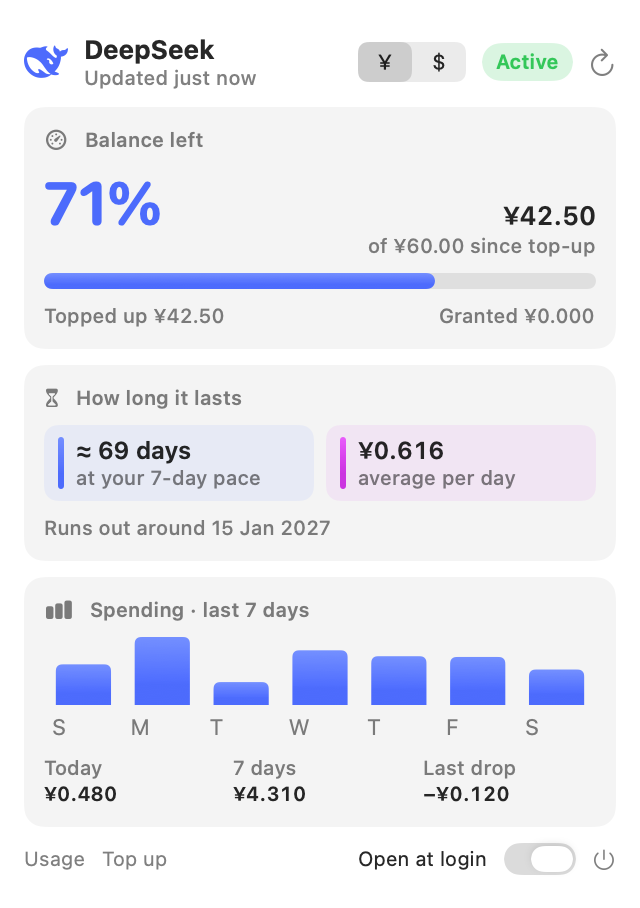

# DeepSeekBar

A small macOS menu bar app that shows your **DeepSeek API balance** at a glance.

<p align="center">
  <picture>
    <source media="(prefers-color-scheme: dark)" srcset="docs/menubar-dark.png">
    
  </picture>
</p>

<p align="center">
  <picture>
    <source media="(prefers-color-scheme: dark)" srcset="docs/screenshot-dark.png">
    
  </picture>
  <br><sub>Demo numbers</sub>
</p>

- 🐋 DeepSeek logo, a mini gauge and **% of balance left** in the menu bar (turns red when low)
- Click it for your balance, **how long it lasts** at your current pace, and **spending today / last 7 days** with a chart
- A macOS **notification when your balance runs low**
- Switch amounts between **¥ CNY and $ USD**
- Optional **Open at login**
- Also includes `balance.mjs`, a command-line version

> Unofficial. Not affiliated with or endorsed by DeepSeek. Your API key stays on your Mac and is only sent to `api.deepseek.com`.

## Requirements

- macOS 13 Ventura or later
- Xcode Command Line Tools (for `swiftc`): `xcode-select --install`
- A DeepSeek API key from [platform.deepseek.com/api_keys](https://platform.deepseek.com/api_keys)
- Node.js 18+ (only for the optional command-line script)

## Install

```bash
git clone https://github.com/mitbol22/deepseekbar.git
cd deepseekbar
cp .env.example .env          # then put your key in DEEPSEEK_API_KEY
./menubar/build.sh            # builds and installs ~/Applications/DeepSeekBar.app
open ~/Applications/DeepSeekBar.app
```

The app reads `.env` from the folder you built it in, so keep the cloned folder where it is (or rebuild after moving it).

To start it automatically, open the panel and turn on **Open at login**.

## How it works

DeepSeek's API only exposes your **balance** (`GET /user/balance`), not per-request usage. So the app:

1. Checks your balance every 15 minutes (change with `DS_REFRESH_MINUTES`) and whenever you open the panel.
2. Saves a snapshot to `history.json` whenever the balance changes.
3. Works out **spending** from the drops between snapshots (top-ups are ignored), and **how long it lasts** from your average daily spend over the last 7 days.

Everything shown is measured from your own balance — there are no price-based guesses. Spending history starts from the first time you run it, so "how long it lasts" fills in after a day or two of use. For per-request and per-token detail, see [platform.deepseek.com/usage](https://platform.deepseek.com/usage).

**What 100% means:** DeepSeek has no quota, only a prepaid balance. By default 100% is your balance right after your latest top-up, and each top-up resets it. Set `DS_BUDGET` to measure against a fixed amount instead.

**Low-balance alert:** you get one notification when the balance drops below `DS_ALERT_PERCENT` (default 15%) or the API is paused, and the menu bar turns red. It re-arms after you top up. To see what it looks like, set `DS_ALERT_PERCENT=101`, click refresh, then remove the line — macOS asks you to allow notifications the first time.

If your account has balances in both CNY and USD, the app shows the one with money in it.

## Settings (`.env`)

| Variable | Default | What it does |
|---|---|---|
| `DEEPSEEK_API_KEY` | — | Your API key (required) |
| `DS_BUDGET` | balance after last top-up | Fixed amount that counts as 100% |
| `DS_ALERT_PERCENT` | `15` | Notify (and turn the menu bar red) below this % |
| `DS_REFRESH_MINUTES` | `15` | How often to check the balance (minimum 1) |
| `DS_CNY_PER_USD` | `7.1` | Exchange rate for the ¥ / $ switch |

Click refresh in the panel after editing `.env`.

## Command-line version

```bash
node balance.mjs             # show balance, record a snapshot
node balance.mjs --history   # show recorded snapshots and spend per day
node balance.mjs --no-save   # check without recording
```

It uses the same `.env` and `history.json` as the app.

## Privacy

- `.env` (your key) and `history.json` (your balance history) are git-ignored and never leave your Mac, except the key being sent to DeepSeek's API.
- The app has no analytics and talks to no server other than `api.deepseek.com`.

## Development

The README screenshots are rendered by the app itself from made-up numbers:

```bash
B=~/Applications/DeepSeekBar.app/Contents/MacOS/DeepSeekBar
$B --render-demo docs/screenshot-light.png light
$B --render-demo docs/screenshot-dark.png dark
$B --render-menubar docs/menubar-light.png light
$B --render-menubar docs/menubar-dark.png dark
```

## Uninstall

Turn off **Open at login**, quit from the panel, then delete `~/Applications/DeepSeekBar.app`.

## Credits

DeepSeek logo SVG from [LobeHub Icons](https://github.com/lobehub/lobe-icons) (MIT). DeepSeek is a trademark of its owner.

## License

[MIT](LICENSE)
